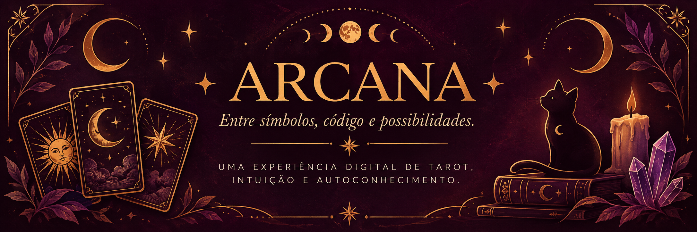

<p align="center">
  
</p>


</p>
# ✦ ARCANA ✦

### 🔮 Entre símbolos, código e possibilidades.

**Uma experiência digital de Tarot, intuição e autoconhecimento.**

Aplicação web em desenvolvimento, criada com foco em experiência do usuário, design sofisticado e desenvolvimento Full Stack.

<br>


<br>


</div>

---

## 🌙 Sobre o ARCANA

O **ARCANA** é um projeto pessoal de desenvolvimento Full Stack que une tecnologia, design e o universo simbólico do Tarot.

A proposta é criar uma plataforma digital na qual usuários possam explorar os significados das cartas, realizar tiragens interativas e registrar suas experiências.

O projeto está sendo desenvolvido de forma incremental, começando pela interface em React e evoluindo futuramente para uma aplicação com API REST, autenticação e banco de dados.

> ✦ Cada carta carrega um símbolo. Cada símbolo, uma possibilidade.

---

## ✨ Funcionalidades

### Implementadas

- [x] Interface inicial com identidade visual própria.
- [x] Navegação entre seções.
- [x] Componentes React organizados.
- [x] Biblioteca de cartas de Tarot.
- [x] Pesquisa de cartas por nome.
- [x] Filtros de Arcanos Maiores e Menores.
- [x] Estrutura inicial de documentação.

### Em desenvolvimento

- [ ] Biblioteca completa com 78 cartas.
- [ ] Ilustrações das cartas.
- [ ] Significados aprofundados.
- [ ] Páginas individuais das cartas.
- [ ] Melhorias de responsividade.

### Funcionalidades futuras

- [ ] Carta do Dia.
- [ ] Tiragens interativas.
- [ ] Interpretação das tiragens.
- [ ] Cadastro e login.
- [ ] Diário pessoal de Tarot.
- [ ] Histórico de tiragens.
- [ ] Integração com API REST.
- [ ] Persistência de dados no PostgreSQL.

---

## 🛠️ Tecnologias

### Frontend

| Tecnologia | Utilização |
|---|---|
| React.js | Construção da interface |
| JavaScript | Lógica e interatividade |
| Vite | Ambiente de desenvolvimento |
| HTML5 | Estrutura das páginas |
| CSS3 | Estilização e responsividade |

### Backend — Planejado

| Tecnologia | Utilização |
|---|---|
| Node.js | Ambiente de execução |
| Express.js | Desenvolvimento da API REST |
| PostgreSQL | Banco de dados |
| Prisma ORM | Modelagem e acesso aos dados |

### Ferramentas

- Visual Studio Code
- Git e GitHub
- Figma
- npm

---

## 🎨 Identidade Visual

O ARCANA utiliza uma estética **Dark & Sophisticated**, inspirada no universo místico e na elegância das cartas de Tarot.

### Paleta de cores

| Cor | Código | Aplicação |
|---|---|---|
| Preto profundo | `#0D0B0F` | Fundo principal |
| Roxo escuro | `#1A151D` | Superfícies |
| Vinho | `#310D1C` | Destaques e gradientes |
| Dourado envelhecido | `#D4A968` | Títulos e detalhes |
| Creme | `#F0DFCF` | Textos principais |
| Rosa acinzentado | `#B9A8AD` | Textos secundários |

### Tipografia

- **Cinzel:** títulos e elementos de destaque.
- **Inter:** textos e componentes da interface.

---

## 📁 Estrutura do Projeto

```text
projeto-tarot/
│
├── docs/
│   ├── ARQUITETURA.md
│   └── ROADMAP.md
│
├── frontend/
│   ├── public/
│   ├── src/
│   │   ├── components/
│   │   │   ├── Header/
│   │   │   ├── Hero/
│   │   │   ├── Features/
│   │   │   └── Biblioteca/
│   │   │
│   │   ├── data/
│   │   ├── App.jsx
│   │   ├── App.css
│   │   └── index.css
│   │
│   └── package.json
│
├── .gitignore
└── README.md
```

A organização dos componentes mantém os arquivos JSX e CSS próximos, facilitando a manutenção e a evolução do frontend.

---

## 🚀 Como Executar o Projeto

### Pré-requisitos

- Node.js
- npm
- Git

### 1. Clone o repositório

```bash
git clone https://github.com/j0rdanaaa/arcana-tarot.git
```

### 2. Acesse a pasta do frontend

```bash
cd arcana-tarot/frontend
```

### 3. Instale as dependências

```bash
npm install
```

### 4. Inicie o servidor

```bash
npm run dev
```

### 5. Abra a aplicação

Acesse o endereço local informado pelo Vite no terminal.

---

## 🏗️ Arquitetura

Atualmente, o ARCANA utiliza uma arquitetura frontend baseada em componentes React, com dados locais em arquivos JavaScript.

A arquitetura Full Stack planejada é:

```text
React
  |
  v
API REST - Node.js + Express
  |
  v
Prisma ORM
  |
  v
PostgreSQL
```

Essa integração será implementada nas próximas fases do projeto.

---

## 📚 Documentação

A documentação acompanha a evolução técnica e funcional do ARCANA.

- [Arquitetura do projeto](docs/ARQUITETURA.md)
- [Roadmap de desenvolvimento](docs/ROADMAP.md)

---

## 🌱 Aprendizados e Objetivos

Este projeto tem como objetivos:

- Aplicar conceitos de React e JavaScript.
- Desenvolver componentes reutilizáveis.
- Praticar organização e manutenção de código.
- Aprimorar habilidades de UI/UX.
- Desenvolver uma aplicação Full Stack completa.
- Trabalhar com APIs REST e bancos de dados.
- Construir um projeto autoral para portfólio.
- Documentar decisões e aprendizados ao longo do desenvolvimento.

---

## 📌 Status do Projeto

**🚧 Em desenvolvimento**

O ARCANA está em construção e receberá novas funcionalidades, melhorias visuais e integrações.

Acompanhe as próximas etapas no [Roadmap](docs/ROADMAP.md).

---

<div align="center">

### ✦ Desenvolvido por Jordana Góes ✦

Projeto pessoal de desenvolvimento Full Stack.

[](https://github.com/j0rdanaaa)

<br>

*Entre símbolos, código e possibilidades.*

**✦ ARCANA ✦**

</div>
